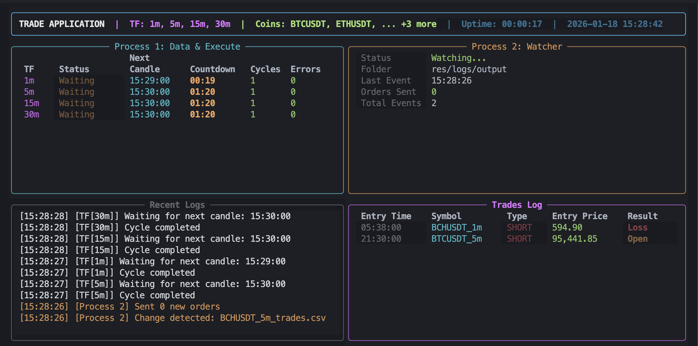

# Bot Trade

Trading bot with real-time dashboard.



## Quick Start

### Local Development

```bash
# 1. Create and activate virtual environment
python -m venv venv
source venv/bin/activate  # Linux/Mac
# venv\Scripts\activate   # Windows

# 2. Install dependencies
pip install --upgrade pip
pip install -r requirements.txt
pip install -e .

# 3. Configure
cp src/trade/config.example.yaml src/trade/config.yaml
# Edit src/trade/config.yaml as needed

# 4. Setup environment variables
# Create .env file with:
TELEGRAM_TOKEN=your_telegram_bot_token
TELEGRAM_CHAT_ID=your_chat_id

# 5. Run
python src/trade/run.py
```

### Docker

```bash
# 1. Prepare config files
cp src/trade/config.example.yaml src/trade/config.yaml
# Create .env file with TELEGRAM_TOKEN and TELEGRAM_CHAT_ID

# 2. Build and run
docker-compose up --build

# Run in background
docker-compose up -d --build

# View logs
docker-compose logs -f bot-trade

# Stop
docker-compose down
```

## Configuration

Edit `src/trade/config.yaml`:

```yaml
data:
  currencies:
    - "BTCUSDT"
    - "ETHUSDT"
  candles_limit: 1000

timeframe:
  value: ["5m", "15m", "30m"]
  delay_seconds: 2
  run_on_start: true
```

## File Structure

```
Bot_Trade/
├── .env                      # Telegram credentials
├── src/trade/config.yaml     # Trading configuration
└── res/logs/                 # Data and output logs
```
