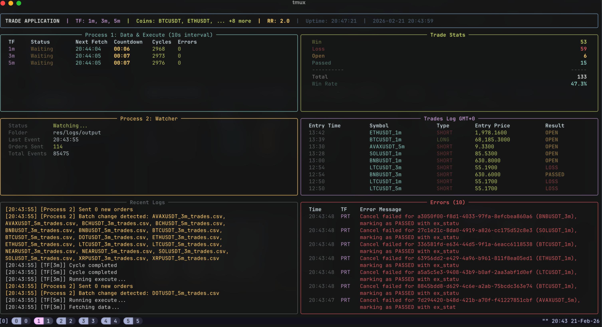
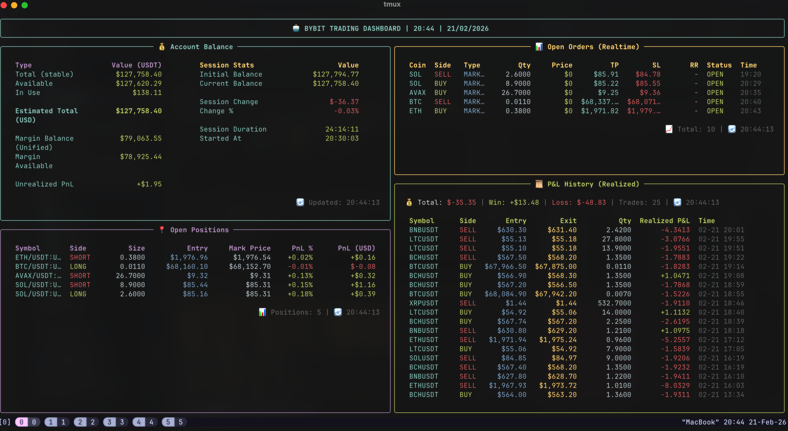

# Bot Trade

Trading bot with real-time dashboard.




## Quick Start

### Local Development

```bash
# 1. Create and activate virtual environment
python -m venv venv
source venv/bin/activate  # Linux/Mac
# venv\Scripts\activate   # Windows

# 2. Install dependencies
pip install --upgrade pip
pip install -r requirements.txt
pip install -e .

# 3. Configure
cp src/config/live.ex.yaml src/config/live.yaml
cp src/config/backtest.ex.yaml src/config/backtest.yaml
cp src/config/strategy.ex.yaml src/config/strategy.yaml
# Edit config files as needed

# 4. Setup environment variables
# Create .env file with:
TELEGRAM_TOKEN=your_telegram_bot_token
TELEGRAM_CHAT_ID=your_chat_id

# 5. Run
python -m src.live.run

# Run backtest
python -m src.backtest.main
```

### Docker

```bash
# 1. Prepare config files
cp src/config/live.ex.yaml src/config/live.yaml
cp src/config/backtest.ex.yaml src/config/backtest.yaml
cp src/config/strategy.ex.yaml src/config/strategy.yaml
# Create .env file with TELEGRAM_TOKEN and TELEGRAM_CHAT_ID

# 2. Build and run
docker-compose up --build

# Run in background
docker-compose up -d --build

# View logs
docker-compose logs -f bot-trade

# Stop
docker-compose down
```

## Configuration

Edit `src/config/live.yaml`, `src/config/backtest.yaml`, and `src/config/strategy.yaml`:

```yaml
risk_reward_ratio: 2.0
```

## Exchange Comparison

USDT perpetuals, base tier (VIP 0). Researched 2026-10. Fees change often, so check each exchange's official fee page before relying on these numbers.

| | **Lighter** | **Binance Futures** | **Bybit Perp** |
|---|---|---|---|
| Type | DEX (zk-rollup on Ethereum), self-custody | CEX | CEX |
| Maker fee | **0%** (Standard account) | 0.02% | 0.02% |
| Taker fee | **0%** (Standard account) | 0.05% (10% off when paid in BNB) | 0.055% |
| Premium / VIP fees | ~0.002–0.004% maker, ~0.02–0.028% taker (sources disagree) | Lower with 30-day volume (VIP 1 from $15M) | Lower with volume, best taker ~0.03% |
| Round-trip taker cost | **0%** | ~0.10% | ~0.11% |
| Latency | Standard has a built-in delay: ~200 ms taker, ~300 ms maker. Premium is faster (~150–200 ms taker) | Matching in microseconds; API round trip ~30–80 ms from Vietnam | Similar to Binance |
| Spread (BTC/ETH) | Tight, but the order book is much thinner, so large orders and altcoins slip more | ~1 tick, deepest market | ~1 tick, close to Binance |
| Markets | Fewer (mostly majors) | Most | Many |
| Funding interval | Every hour | Every 8h (some pairs 4h/1h) | Every 8h (some pairs shorter) |
| Main risks | Smart contracts, young project, limited API docs | Centralized custody, KYC | Centralized custody, KYC (hacked in 2025) |

What this means for this bot:

- **Fees decide whether a strategy is profitable.** With the stop-loss 1% from entry, a Binance taker round trip (~0.10%) costs about 0.1R per trade. On Lighter Standard that cost is close to zero, leaving only spread and slippage.
- **Latency of 200–300 ms does not matter** for 1h-candle signals. It only hurts scalping, market making, or strategies that need fast cancels.
- **Still model spread and slippage on Lighter**, especially for altcoins. Do not assume trading there costs nothing.

Sources: [Mobula perps fees](https://docs.mobula.io/perps-fees), [Lighter review (cryptowinrate)](https://cryptowinrate.com/crypto-exchanges/lighter/?p=1191), [Binance futures fees (Finder)](https://www.finder.com/binance-futures-fees), [Bybit perpetual fees](https://www.bybit.com/my-MM/help-center/article/Perpetual-Futures-Contract-Fees-Explained), [Bybit vs Binance fees (Coinperps)](https://www.coinperps.com/zh/learn/bybit-vs-binance-perpetual-futures-fees).

## File Structure

```
Bot_Trade/
├── .env                      # Telegram credentials
├── src/config/live.yaml      # Live runtime configuration
├── src/config/backtest.yaml  # Backtest runtime configuration
├── src/config/strategy.yaml  # Shared strategy configuration
└── res/logs/                 # Data and output logs
```
